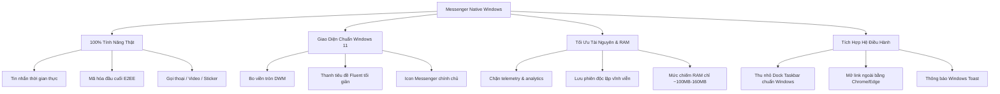

# 🚀 Tổng Quan Ứng Dụng Messenger Native cho Windows

> **Tên dự án:** Messenger Native (C# / WPF / .NET 8)  
> **Nền tảng mục tiêu:** Windows 10 / Windows 11  
> **Ngôn ngữ & Công nghệ:** C#, WPF, Microsoft Edge WebView2 Evergreen, Windows 11 DWM API  
> **Kho mã nguồn:** `C:\Users\trong\Downloads\Code\Mess\MessengerNative`

---

## 1. Bối cảnh & Vấn đề thực tế (Problem Statement)

Vào cuối năm 2023 – đầu năm 2024, **Meta chính thức khai tử ứng dụng Messenger Desktop độc lập trên Windows (bản UWP/Electron cũ)** và yêu cầu người dùng chuyển sang sử dụng phiên bản Web (`facebook.com` hoặc `messenger.com`). 

Điều này gây ra nhiều bất tiện nghiêm trọng cho người dùng máy tính:
1. **Thao tác rườm rà:** Mỗi lần muốn chat phải mở trình duyệt web, tìm tab Messenger trong hàng chục tab đang mở, dễ bị phân tâm bởi Newsfeed Facebook.
2. **Chiếm dụng RAM khủng khiếp:** Trình duyệt Chrome / Edge thông thường mở tab Facebook tiêu tốn từ **600MB – 1.2GB RAM**, kéo theo hàng tá tiện ích mở rộng (extensions), bộ giải mã video ngầm và theo dõi quảng cáo.
3. **Mất chất "Native":** Không có icon độc lập dưới thanh Dock/Taskbar, không hỗ trợ điều hướng nhanh, dễ vô tình bấm tắt mất tab chat quan trọng.
4. **Không tùy biến được:** Không thể can thiệp bo góc Windows 11, không chặn được các script thừa hoặc tối ưu giao diện theo nhu cầu riêng.

---

## 2. Mục tiêu của ứng dụng Messenger Native

Dự án được xây dựng để mang lại **trải nghiệm Messenger đích thực, tiện lợi và nhẹ nhàng nhất** cho người dùng Windows:

---

## 3. Bản đồ Tài liệu Nghiệp vụ (Vault Sitemap)

Tài liệu được phân chia thành các thư mục chuyên sâu sau:

### 📂 1. Nghiệp Vụ Ứng Dụng (`Nghiep-Vu/`)
* [[01_Xac-Thuc-Va-Quan-Ly-Phien]]: Quy trình đăng nhập, xác thực 2FA, lưu trữ phiên đăng nhập vĩnh viễn.
* [[02_Trai-Nghiem-Va-Giao-Dien]]: Tiêu chuẩn thiết kế Windows 11 Fluent, bo góc viền, thanh tiêu đề tối giản.
* [[03_Dong-Bo-Tin-Nhan-Va-Thong-Bao]]: Bắt sự kiện tin nhắn mới, cập nhật tiêu đề, thông báo Windows Action Center.
* [[04_Quan-Ly-Dieu-Huong-Va-Lien-Ket-Ngoai]]: Quy tắc mở link ngoài, cô lập trải nghiệm chat.

### 📂 2. Kiến Trúc & Kỹ Thuật (`Kien-Truc-Va-Ky-Thuat/`)
* [[01_Kien-Truc-Tong-The-Native-Shell]]: Mô hình Native Shell kết hợp WPF + WebView2.
* [[02_Toi-Uu-Bo-Nho-Va-Hieu-Nang]]: Các cờ Chromium tối ưu tài nguyên, quản lý RAM.
* [[03_Tich-Hop-Windows-11-DWM]]: Kỹ thuật P/Invoke `DwmSetWindowAttribute`, `WindowChrome` và icon `.ico`.
* [[04_Dong-Goi-Va-Phat-Hanh-Installer]]: Đóng gói xuất xưởng dạng Portable và bộ cài đặt Setup tự động (Inno Setup).

### 📂 3. Bảo Mật & Giao Thức Meta (`Bao-Mat-Va-E2EE/`)
* [[01_Co-Che-Ma-Hoa-Dau-Cuoi]]: Tại sao Meta dùng E2EE WebAssembly, rủi ro của việc reverse API và lý do chọn Native Shell.

### 📂 4. Quyết Định Thiết Kế (Architecture Decision Records - ADR)
* [[ADR-001-Kien-Truc-Native-Shell-Thay-Vi-Reverse-API]]: Lý do từ bỏ mock/reverse API để dùng Native Shell.
* [[ADR-002-Loai-Bo-System-Tray-Chuyen-Ve-Dock]]: Quyết định gỡ bỏ khay hệ thống, giữ chuẩn dock Windows.
* [[ADR-003-Su-Dung-Titlebar-Goc-Windows-11]]: Chuyển sang thanh tiêu đề và bộ icon điều khiển gốc của Windows 11.
* [[ADR-004-Hieu-Ung-Kinh-Mo-Mica-Va-Adaptive-Theme]]: Tích hợp hiệu ứng kính mờ Mica & Adaptive Theme tự động.
