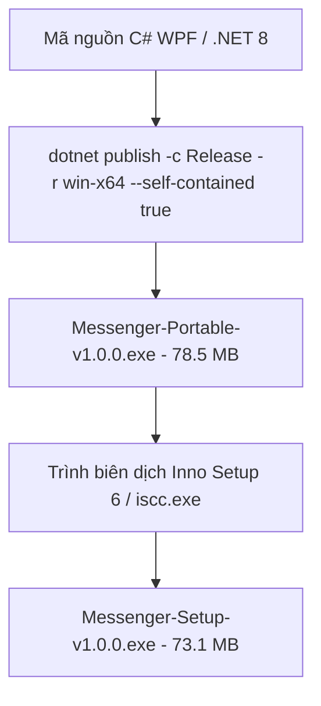

# 📦 Kiến Trúc & Quy Trình: Đóng Gói Và Phát Hành Cài Đặt

Tài liệu này đặc tả cơ chế đóng gói phần mềm thành gói cài đặt độc lập, có thể mang đi cài đặt và chạy ngay trên bất kỳ máy tính Windows 10/11 nào mà không cần cài đặt môi trường .NET SDK hay runtime bên ngoài.

---

## 1. Hai Định Dạng Phát Hành (Release Formats)

Toàn bộ sản phẩm được xuất vào thư mục:
`C:\Users\trong\Downloads\Code\Mess\Release-Output\`

| Tên Tệp Tin | Kích Thước | Định Dạng | Mô Tả & Đối Tượng Sử Dụng |
| :--- | :--- | :--- | :--- |
| **`Messenger-Setup-v1.0.0.exe`** | ~73.1 MB | Windows Installer | Bộ cài đặt chuyên nghiệp (Inno Setup). Hỗ trợ giao diện cài đặt từng bước, tự tạo Shortcut ra Màn hình chính (Desktop) & Menu Start, hỗ trợ gỡ cài đặt (Uninstall) trong Windows Settings. |
| **`Messenger-Portable-v1.0.0.exe`** | ~78.5 MB | Portable Single-File | File chạy trực tiếp không cần cài đặt. Chỉ cần chép vào USB, gửi qua Zalo / Telegram / Google Drive, bấm đúp chuột là chạy ngay. |

---

## 2. Đặc Tính Kỹ Thuật Đóng Gói

### 2.1. Độc lập hoàn toàn môi trường (Self-Contained)
* **Embedded Runtime:** Đóng gói kèm toàn bộ .NET 8 Desktop Runtime (`Microsoft.WindowsDesktop.App.Runtime.win-x64`) và Core Runtime (`Microsoft.NETCore.App.Runtime.win-x64`).
* **Máy đích không cần cài đặt trước .NET:** Dù máy người dùng là máy tính mới cài lại Windows, máy văn phòng bị hạn chế quyền cài đặt phần mềm phụ trợ, ứng dụng vẫn khởi chạy 100% mượt mà.
* **WebView2 Runtime:** Tận dụng thành phần Microsoft Edge WebView2 có sẵn trên tất cả các máy Windows 10 (bản cập nhật từ 2021) và Windows 11 mặc định.

### 2.2. Nén cấp cao LZMA2 Ultra
* Bằng cách kết hợp cơ chế nén `PublishSingleFile` của .NET và nén `lzma2/ultra64` của Inno Setup, toàn bộ ứng dụng desktop đầy đủ tính năng chỉ chiếm vỏn vẹn **~73 MB** dung lượng cài đặt.

### 2.3. Cài đặt không yêu cầu quyền Quản trị viên (Admin Rights)
* Gói cài đặt cấu hình `PrivilegesRequired=lowest` kết hợp `PrivilegesRequiredOverridesAllowed=dialog`.
* Người dùng thông thường (Standard User) có thể cài đặt trực tiếp vào `%LocalAppData%\Programs\Messenger` mà **không bị hộp thoại UAC hỏi mật khẩu Administrator**.
* Nếu chạy với quyền Admin, người dùng có thể tùy chọn cài đặt cho toàn bộ người dùng trên máy vào `Program Files`.

---

## 3. Quy Trình Biên Dịch & Đóng Gói (Build Pipeline)



### Lệnh thực thi:
1. **Xuất bản bản Portable:**
   ```powershell
   dotnet publish MessengerNative/MessengerNative.csproj -c Release -r win-x64 --self-contained true -p:PublishSingleFile=true -p:IncludeNativeLibrariesForSelfExtract=true -p:EnableCompressionInSingleFile=true -o Release-Output/Portable
   ```
2. **Đóng gói Installer:**
   ```powershell
   & "C:\Users\trong\AppData\Local\Programs\Inno Setup 6\iscc.exe" Installer/Messenger.iss
   ```

---

## 4. Hướng Dẫn Sử Dụng Cho Người Dùng Khác

1. **Cách 1 - Cài đặt vào máy (Khuyên dùng):**
   * Gửi file `Messenger-Setup-v1.0.0.exe` cho người khác.
   * Người nhận nhấn đúp chuột -> chọn *Next* -> *Install* -> *Finish*.
   * Biểu tượng Messenger sẽ xuất hiện trên Desktop và Menu Start.
2. **Cách 2 - Dùng ngay không cần cài (Portable):**
   * Gửi file `Messenger-Portable-v1.0.0.exe`.
   * Người nhận để file ở bất kỳ thư mục nào (hoặc trên USB) và nhấn đúp chuột là sử dụng được ngay.
