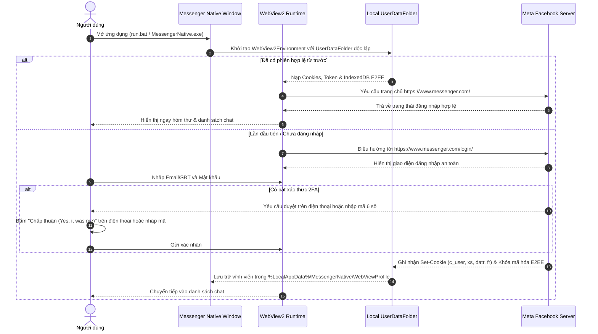

# 🔐 Nghiệp Vụ: Xác Thực & Quản Lý Phiên Đăng Nhập

Tài liệu này mô tả chi tiết luồng nghiệp vụ xác thực người dùng, xử lý xác minh 2 bước (2FA), và kiến trúc lưu trữ phiên đăng nhập bền vững của ứng dụng **Messenger Native**.

---

## 1. Mục tiêu Nghiệp Vụ

1. **Đăng nhập một lần duy nhất:** Người dùng chỉ cần đăng nhập thành công trong lần đầu tiên sử dụng. Toàn bộ các lần bật ứng dụng tiếp theo sẽ tự động vào thẳng màn hình chat ngay tức khắc (< 1 giây).
2. **Hỗ trợ đầy đủ các phương thức bảo mật của Facebook:** Mật khẩu, mã xác thực 2FA (Google Authenticator / Duo), phê duyệt trên thiết bị di động (Samsung, iPhone...), Passkey và khóa bảo mật phần cứng (FIDO2).
3. **Cô lập phiên làm việc:** Dữ liệu tài khoản của ứng dụng không dùng chung với trình duyệt ngoài (Chrome/Edge), tránh xung đột tài khoản hoặc vô tình bị đăng xuất khi người dùng xóa cache web ngoài.

---

## 2. Quy Trình Nghiệp Vụ Đăng Nhập (Login Workflow)

---

## 3. Đặc Tả Chi Tiết Xử Lý Xác Minh 2 Bước (2FA Checkpoint)

Một trong những vấn đề phổ biến nhất của người dùng Facebook hiện đại là tính năng phê duyệt trên thiết bị di động:

### 3.1. Hiện tượng kẹt tại Checkpoint
* Khi người dùng đăng nhập trên một thiết bị mới, Meta gửi thông báo phê duyệt tới điện thoại (ví dụ: *"Kiểm tra thông báo trên Samsung Galaxy / iPhone để tiếp tục"*).
* Khi người dùng bấm duyệt trên điện thoại, máy chủ Meta đã kích hoạt phiên, nhưng giao diện web trên máy tính không tự động chuyển tiếp nếu thiếu tương tác từ trình duyệt.

### 3.2. Giải pháp trong ứng dụng
* Cung cấp nút **Nạp lại trang (`F5` / `BtnNavReload`)** trực tiếp trên thanh Header.
* Khi người dùng đã duyệt trên điện thoại, chỉ cần nhấn nút nạp lại (hoặc bấm `F5`), ứng dụng sẽ gửi ngay một HTTP request mới lên server Meta. Meta xác nhận phiên đã duyệt thành công và cấp đầy đủ token `c_user` và `xs`, hoàn tất quá trình đăng nhập.

---

## 4. Quản Lý Vùng Lưu Trữ Phiên (Session Storage Engine)

* **Vị trí lưu trữ cục bộ:**  
  `%LocalAppData%\MessengerNative\WebViewProfile\`
* **Thành phần được lưu trữ:**
  * **Cookies:** Chứa `c_user` (ID người dùng), `xs` (Session Token), `datr`, `fr`.
  * **IndexedDB & LocalStorage:** Chứa cơ sở dữ liệu tin nhắn mã hóa và **Khóa mã hóa đầu cuối (Signal Protocol Ratchet Keys)**.
  * **HTTP Cache:** Avatar, biểu tượng cảm xúc (emoji), sticker đã tải để hiển thị tức thì mà không cần tải lại từ mạng.

> [!NOTE]
> Nhờ cơ chế lưu trữ độc lập tại `%LocalAppData%\MessengerNative\WebViewProfile`, người dùng có thể thoải mái xóa lịch sử duyệt web trên Chrome/Edge mà **không bao giờ bị mất đăng nhập trên app Messenger Native**.

---

## 5. Nghiệp Vụ Đăng Xuất (Logout)

Khi người dùng muốn chuyển tài khoản hoặc thoát hẳn:
1. Thao tác trên giao diện Messenger: Bấm vào avatar góc dưới bên trái $\rightarrow$ Chọn **Đăng xuất (Log Out)**.
2. Ứng dụng dọn sạch cookie trong phiên làm việc và đưa người dùng quay lại màn hình đăng nhập ban đầu.
3. Không để sót token nhạy cảm trong bộ nhớ tạm.
