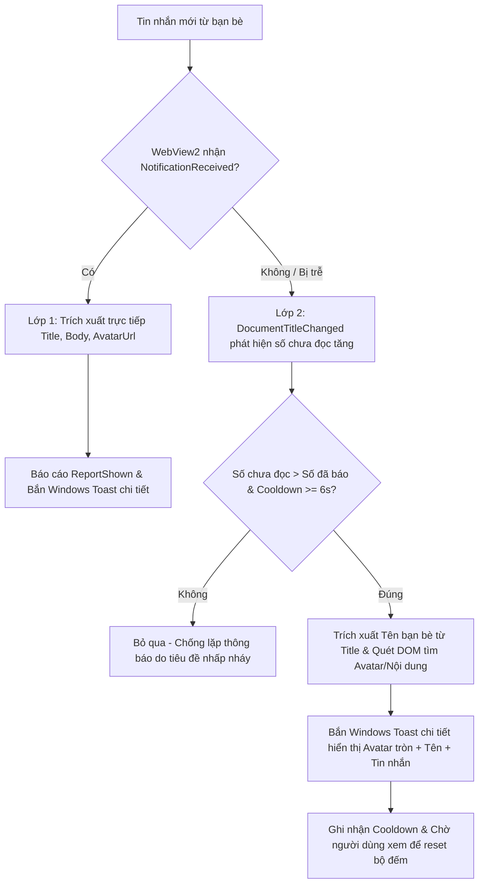

# 🔔 Nghiệp Vụ: Đồng Bộ Tin Nhắn & Thông Báo Hệ Thống

Tài liệu này đặc tả cơ chế nhận diện tin nhắn thời gian thực, quản lý số đếm chưa đọc (Unread Count), bắn thông báo Windows Action Center và hành vi tương tác với thanh tác vụ (Taskbar / Dock).

---

## 1. Cơ Chế Nhận Diện & Trích Xuất Thông Báo Chi Tiết (Dual-Layer Engine)

Trước đây, thông báo chỉ dựa trên việc đếm số trong tiêu đề `(1) Messenger` dẫn đến thông báo chung chung (`Bạn có 1 tin nhắn chưa đọc.`). Hiện tại, ứng dụng nâng cấp lên cơ chế 2 lớp thông minh:

### 1.1. Lớp 1: Can thiệp trực tiếp Web Push (`CoreWebView2.NotificationReceived`)
* Khi Messenger Web phát sinh thông báo đẩy, ứng dụng chặn sự kiện `NotificationReceived` qua `args.Handled = true`.
* Trích xuất các trường dữ liệu gốc cực kỳ chuẩn xác:
  * **Người gửi (Title):** Tên bạn bè hoặc nhóm chat (vd: `Park Công Viên`, `Chíp Chíp❤️`, `Zũ Đại en ter thai mừn`).
  * **Nội dung tin nhắn (Body):** Đoạn tin nhắn thực tế (vd: `📷 File đính kèm`, `Em tan học r ạaa`).
  * **Ảnh đại diện (IconUri):** URL Avatar chất lượng cao từ CDN của Meta.

### 1.2. Lớp 2: Trích xuất tiêu đề kết hợp quét DOM đa tầng (DOM & Title Scraper)
* **Bóc tách Tên từ Title:** Khi tiêu đề trang Facebook có dạng `(1) Park Công Viên`, ứng dụng tự động bóc tách tên người gửi trực tiếp từ Title (`Regex.Match(rawTitle, @"\((\d+)\)\s*(.+)")`).
* **Quét DOM thông minh hỗ trợ SVG Avatar:** Facebook Messenger Comet sử dụng thẻ SVG `<image xlink:href="...">` thay vì `` truyền thống. Script quét DOM hỗ trợ cả hai loại thẻ và bóc tách nội dung tin nhắn gần nhất (`snippet`) cùng Avatar URL để hiển thị thông báo trực quan.

### 1.3. Cơ chế triệt tiêu vòng lặp thông báo vô tận (Anti-Spam / Anti-Loop Guard)
* **Hiện tượng:** Facebook Messenger Web có cơ chế nhấp nháy tiêu đề cửa sổ liên tục nhằm thu hút sự chú ý của người dùng khi có tin nhắn mới:  
  `(1) Đoạn chat` $\leftrightarrow$ `Đoạn chat` (lặp lại mỗi 1 - 2 giây).
* **Khắc phục:**  
  * Ứng dụng **tuyệt đối không reset** biến đếm `_lastNotifiedUnreadCount` về `0` khi tiêu đề chuyển sang `Đoạn chat` nếu người dùng chưa tương tác với cửa sổ.
  * Bộ đếm chỉ được xóa khi cửa sổ nhận sự kiện người dùng kích hoạt/đọc tin (`Activated`).
  * Bổ sung cơ chế Cooldown tối thiểu 6 giây giữa 2 lần gửi thông báo.  
  $\rightarrow$ Người dùng chỉ nhận **đúng 1 thông báo duy nhất** cho mỗi tin nhắn mới, không bị bắn lặp lại liên tục.

---

## 2. Xử Lý Tương Tác Khi Có Thông Báo (Chống Treo Ứng Dụng Khi Nhận & Bấm Thông Báo)

### 2.1. Nguyên nhân cốt lõi gây đơ ứng dụng trước đây
1. **Lỗi `CanUseHttpImages == false` trong Win32 Unpackaged App:**
   * Trong ứng dụng Win32 truyền thống (.NET WPF không đóng gói MSIX), cờ hệ thống `ToastNotificationManagerCompat.CanUseHttpImages` là `false`.
   * Khi truyền thẳng URL ảnh CDN của Facebook (`https://scontent...`) vào `AddAppLogoOverride(avatarUri)`, hệ điều hành Windows Toast cố gắng tải ảnh từ xa trên luồng COM nhưng không có môi trường container MSIX, dẫn đến việc **hệ thống thông báo của Windows bị treo cứng (Deadlock)**.
   * Lệnh `builder.Show()` trước đây chạy đồng bộ trên luồng chính của WPF, kéo theo toàn bộ cửa sổ bị đóng băng ngay khi có thông báo (`Messenger (Not Responding)`).
2. **Tranh chấp cổng thông báo (RPC Queue Flooding):** Vòng lặp bắn thông báo mỗi 1-2 giây làm tắc nghẽn hàng đợi RPC của Windows Action Center.
3. **Handle cửa sổ bằng 0 (`MainWindowHandle == 0`):** Khi ứng dụng dùng WPF không viền, hàm Win32 của .NET `Process.MainWindowHandle` trả về `0`. Tiến trình phụ được Windows kích hoạt không tìm thấy cửa sổ chính và bị kẹt ngầm.

### 2.2. Giải pháp kỹ thuật xử lý triệt để
1. **Chuyển 100% việc bắn thông báo sang luồng phụ (`Task.Run`):**
   * Toàn bộ logic tạo Toast và gọi `builder.Show()` được đưa vào `Task.Run(async () => { ... })`.
   * Luồng giao diện chính (WPF UI Thread) được giải phóng 100% ngay tức thì (0ms), WebView2 tiếp tục hoạt động mượt mà không bao giờ bị đơ.
2. **Bộ Nhớ Đệm Ảnh Đại Diện Cục Bộ (Local Avatar Cache):**
   * Thay vì truyền link HTTP trực tiếp, ứng dụng tự động tải ảnh đại diện bất đồng bộ về `%LocalAppData%\MessengerNative\Cache\Avatars\{MD5}.jpg` với thời gian chờ tối đa 1.5 giây.
   * Khi hoàn tất, truyền URI cục bộ chuẩn `file:///` cho Windows Toast hiển thị avatar tròn cực mượt.
   * Nếu quá 1.5 giây hoặc mất mạng, hệ thống tự động fallback hiển thị thông báo chữ bình thường, tuyệt đối không làm đơ ứng dụng.
3. **Giới hạn thời gian quét DOM (1s Timeout Guard):**
   * Lệnh `ExecuteScriptAsync` quét DOM được bảo vệ bởi `Task.WhenAny(..., Task.Delay(1000))`, đảm bảo trang web có bận đến đâu cũng không thể giữ chân luồng xử lý.
4. **Phát tín hiệu liên tiến trình qua Windows Message (`RegisterWindowMessage` + `PostMessage`):**
   * Đăng ký mã thông điệp hệ thống: `MESSENGER_NATIVE_ACTIVATE_WINDOW_98761B90`.
   * Tiến trình phụ khi nhấp vào thông báo sẽ gửi lệnh qua `PostMessage(HWND_BROADCAST, ...)` rồi tự hủy lập tức (`Environment.Exit(0)`).
   * Tiến trình chính nhận thông điệp qua `WndProc` và gọi `SwitchToThisWindow(hwnd, true)` kết hợp `ShowWindow(hwnd, SW_RESTORE)` để đưa ứng dụng lên màn hình êm ái.

---

## 3. Hành Vi Tương Tác Thanh Tác Vụ (Taskbar / Dock Behavior)

Theo đúng yêu cầu tối giản và tiêu chuẩn của ứng dụng máy tính:

### 3.1. Nhấp nháy cảnh báo thanh Dock khi có tin nhắn mới (Taskbar Flash Alert)
* Khi có tin nhắn mới đến trong lúc cửa sổ **đang ở dưới nền** (`!IsActive`) hoặc **đang bị thu nhỏ** (`WindowState == Minimized`):
  * Ứng dụng tự động gọi Win32 API **`FlashWindowEx`** với cờ `FLASHW_ALL | FLASHW_TIMERNOFG`.
  * **Trải nghiệm trên Windows 11:** Icon Messenger trên thanh Taskbar sẽ nhấp nháy vài lần để gây chú ý, sau đó duy trì **thanh gạch chân phát sáng màu đỏ/cam** (Attention Indicator) dưới icon.
  * **Tự động tắt khi xem:** Ngay khi người dùng nhấp vào ứng dụng hoặc thanh dock để đọc tin nhắn (sự kiện `Activated` hoặc `BringToFront()`), ứng dụng lập tức gọi `FlashWindowEx(FLASHW_STOP)` để thanh đỏ biến mất và trở về trạng thái bình thường.

### 3.2. Thu nhỏ cửa sổ (Minimize)
* Khi người dùng nhấn nút **Minimize `[—]`** hoặc phím tắt `Win + Down`:
  * Cửa sổ thu nhỏ trực tiếp xuống **thanh Taskbar (Dock)** của Windows.
  * Icon Messenger gradient vẫn hiển thị rõ ràng trên thanh Taskbar.
  * Người dùng chỉ cần click 1 chạm vào icon trên Taskbar để phóng to lại cửa sổ ngay tức khắc.
  * **Không làm biến mất app vào khay hệ thống (System Tray)**.

### 3.3. Đóng cửa sổ (Close)
* Khi người dùng nhấn nút **Close `[✕]`** hoặc phím tắt `Alt + F4`:
  * Ứng dụng kết thúc hoàn toàn tiến trình (`Application.Current.Shutdown()`).
  * Giải phóng 100% RAM và tài nguyên CPU về cho hệ điều hành.
  * Không chạy ngầm âm thầm gây tốn pin hoặc nóng máy.
