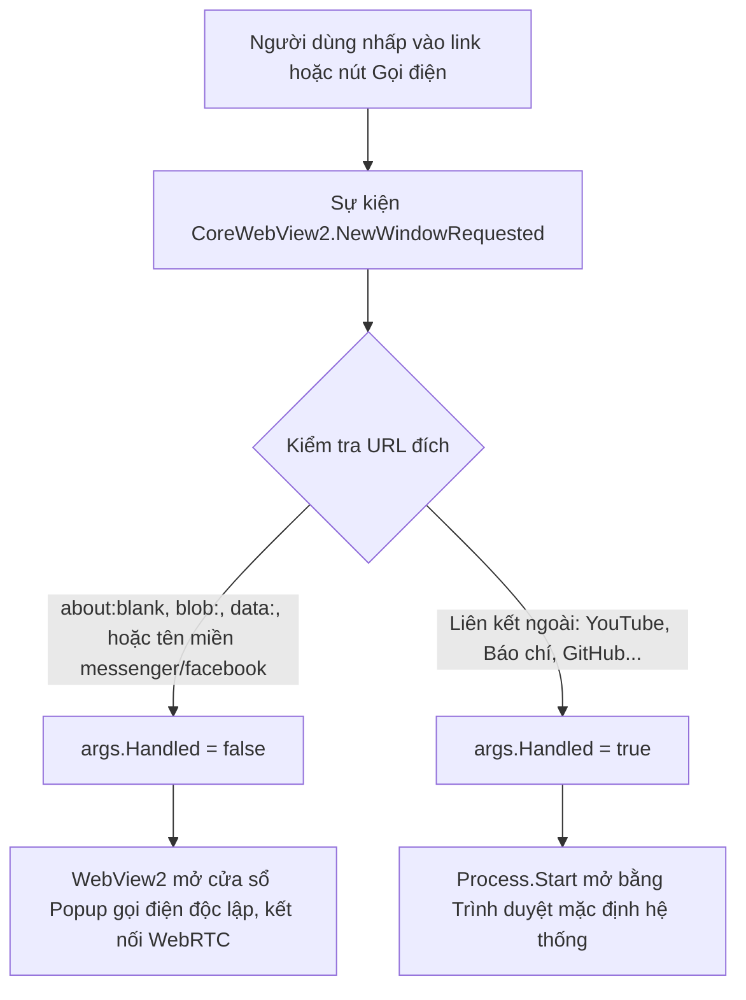

# 🌐 Nghiệp Vụ: Quản Lý Điều Hướng & Cuộc Gọi Thoại / Video

Tài liệu này đặc tả quy tắc phân luồng URL, phân biệt giữa liên kết ngoài và cửa sổ gọi điện (Voice / Video Call), cùng cơ chế cấp quyền Camera & Microphone.

---

## 1. Vấn Đề Nghiệp Vụ & Sự Cố 'about:blank'

1. **Liên kết web thông thường:**
   * Bạn bè gửi video YouTube, báo chí, GitHub... cần được mở bằng trình duyệt mặc định (Chrome / Edge) để không làm mất màn hình chat và không tốn RAM ứng dụng.
2. **Cửa sổ gọi điện (Voice / Video Call):**
   * Khi người dùng nhấn nút Gọi thoại hoặc Video Call, Messenger sử dụng mã script khởi tạo cửa sổ popup: `window.open('about:blank', ...)` sau đó mới nạp phòng gọi WebRTC.
   * **Lỗi phát sinh trước đó:** Nếu ứng dụng chặn tất cả cửa sổ mới và đẩy sang hệ điều hành `Process.Start("about:blank")`, Windows sẽ báo lỗi: *"Get an app to open this 'about' link"*, đồng thời hủy luôn cửa sổ gọi điện của Messenger.
3. **Quyền truy cập Camera, Microphone & Autoplay:**
   * Cuộc gọi WebRTC đòi hỏi quyền Microphone (thu âm), Camera (video) và Autoplay (phát chuông reo và tiếng đàm thoại mà không bị trình duyệt chặn phát âm thanh).

---

## 2. Quy Tắc Phân Luồng Điều Hướng (Smart Routing Rules)

Ứng dụng thiết lập bộ lọc phân loại URL thông minh:



---

## 3. Cấu Hình Cấp Quyền Tự Động (Auto-Grant Permissions)

Để cuộc gọi kết nối ngay lập tức mà không bao giờ bị hỏi popup làm phiền:

1. **Pre-grant Permissions:** Cấp trước quyền Microphone, Camera, Notifications và Autoplay vào Profile ứng dụng cho các tên miền:
   * `https://www.messenger.com`
   * `https://www.facebook.com`
   * `https://web.facebook.com`
2. **Cờ Chromium Autoplay:** Kích hoạt `--autoplay-policy=no-user-gesture-required` để chuông cuộc gọi reo ngay lập tức khi có người gọi tới.

```csharp
// Phân luồng cửa sổ cuộc gọi vs liên kết ngoài
WvMessenger.CoreWebView2.NewWindowRequested += (s, args) =>
{
    var uri = args.Uri ?? string.Empty;

    bool isInternal = string.IsNullOrEmpty(uri) ||
                      uri.StartsWith("about:", StringComparison.OrdinalIgnoreCase) ||
                      uri.StartsWith("blob:", StringComparison.OrdinalIgnoreCase) ||
                      uri.StartsWith("data:", StringComparison.OrdinalIgnoreCase) ||
                      uri.Contains("messenger.com", StringComparison.OrdinalIgnoreCase) ||
                      uri.Contains("facebook.com", StringComparison.OrdinalIgnoreCase) ||
                      uri.Contains("fb.com", StringComparison.OrdinalIgnoreCase);

    if (isInternal)
    {
        // Cho phép mở popup cuộc gọi WebRTC nội bộ
        args.Handled = false;
        return;
    }

    // Liên kết ngoài mở bằng trình duyệt mặc định của máy
    args.Handled = true;
    try
    {
        if (Uri.TryCreate(uri, UriKind.Absolute, out var parsedUri) &&
            (parsedUri.Scheme == Uri.UriSchemeHttp || parsedUri.Scheme == Uri.UriSchemeHttps))
        {
            Process.Start(new ProcessStartInfo(uri) { UseShellExecute = true });
        }
    }
    catch { }
};
```

---

## 4. Lợi Ích Của Cơ Chế Này

1. **Gọi điện & Video Call mượt mà:** Cửa sổ gọi điện bung ra đúng chuẩn, mic và webcam hoạt động ngay lập tức, đàm thoại song song trong khi vẫn nhắn tin bình thường.
2. **Bảo tồn không gian làm việc:** Các liên kết web ngoài vẫn mở trên trình duyệt mặc định của hệ thống.
3. **An toàn bảo mật:** Cách ly hoàn toàn mã nguồn bên ngoài khỏi môi trường desktop.
